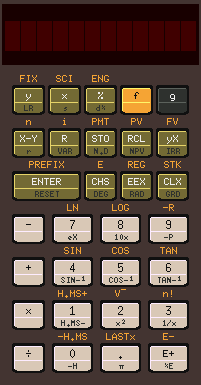
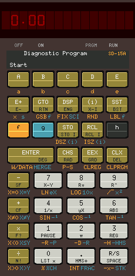
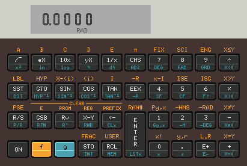
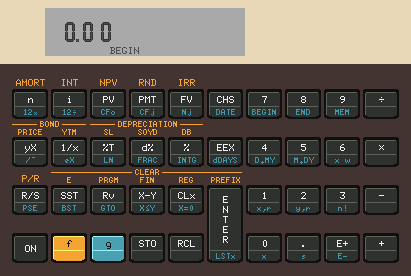

<a id="top"></a>

[](https://flathub.org/en-GB/apps/io.github.mike632t.x11-calc)
[](https://repology.org/project/x11-calc/versions)


## x11-calc - Une autre calculatrice RPN (notation polonaise inversée)

Comprend des émulateurs pour les calculatrices HP35, HP80, HP45, HP70, HP55, HP21, HP22, HP25,
HP25C, HP27, HP29C, HP31E, HP32E, HP33E, HP33C, HP34C, HP37E, HP38C, HP38E,
HP10, HP67, HP10C, HP11C, HP12C, HP15C et HP16C.

Entièrement écrit en C avec X11.

L'utilisation d'extensions du langage ou de fonctionnalités non standard a été
évitée afin de rendre le code aussi portable que possible.

L'objectif est de permettre la compilation du même code source sans modification
sur autant de systèmes et d'architectures que possible, notamment Linux, NetBSD,
MacOS, VMS, Solaris et Tru64 Unix.

  

 

### Sommaire <sup><sup>[Retour en haut](#top)</sup></sup>

- [Modifications](#changes)

- [Installation/Compilation](#obtaining)

- [Systèmes testés](#tested)

- [Guide de l'utilisateur](./GUIDE.md#top)

- [Problèmes connus](#issues)

- [Remerciements](#acknowledgements)

- [Signaler un problème](#problems)

- [Autres captures d'écran](./img/#top)

<a id="changes"></a>
### Modifications <sup><sup>[Retour en haut](#top)</sup></sup>

Détails des modifications récentes et importantes.

20 Mar 26  (0.26.0251)

  - Réécriture du gestionnaire du clavier.
  - Les frappes de touches non valides sont désormais ignorées.
  - Correction d'un bogue dans l'analyseur de la ligne de commande.

03 Jan 26  (0.24.0234)

  - Modification de la manière dont l'affichage est dessiné et augmentation de la plage de valeurs
    autorisées par '--zoom'.
  - Pour modifier la taille de la fenêtre, vous pouvez également maintenir la touche Ctrl enfoncée et utiliser
    la molette de la souris pour effectuer un zoom avant ou arrière.

23 Dec 25  (0.23.0226)

  - Correction d'un bogue qui entraînait l'ignorance de la géométrie lorsqu'une valeur était égale à zéro.

14 Dec 25  (0.23.0224)

  - Les fichiers de cartes de programmes HP67 peuvent désormais contenir des étiquettes textuelles.
  - Ajout de la prise en charge du portugais pour les textes d'aide et les messages d'erreur.

19 Nov 25

  - Permet d'augmenter la taille de la mémoire depuis la ligne de commande. Cette possibilité
    peut ensuite être utilisée par des versions modifiées du micrologiciel pour fournir des registres
    supplémentaires et davantage d'étapes de programme.

18 Oct 25

  - Ajout de la prise en charge du lecteur de cartes HP67 (nécessite GTK).

14 Sep 25  (0.19.0194)

  - Ajout de la HP55, avec son chronomètre.

05 Sep 25  (0.18.0188)

  - Correction de problèmes qui empêchaient l'affichage de la boîte de dialogue de sélection de fichiers
    lors de l'utilisation de Flatpak.

24 Aug 25  (0.18.0187)

  - La HP37E réussit désormais son autotest.
  - Le chargement ou l'enregistrement de l'état actuel peut désormais être effectué par un clic droit
    sur la fenêtre de l'application. En mode `run`, l'utilisateur sera invité à charger l'état depuis un
    fichier `.dat` (données) précédemment enregistré, tandis qu'en mode `prgm`,
    l'utilisateur sera invité à enregistrer l'état actuel.

09 Aug 25  (0.17.0181)

  - Amélioration de l'actualisation de l'affichage (utilisation du double tampon).
  - Modifications mineures pour corriger des problèmes de compilation sur VAX et DEC Windows.

08 Jul 25

  - Enfin réussi à faire fonctionner la HP10 !!
    À noter qu'il n'y a pas d'affichage graphique pour l'imprimante ; la sortie est envoyée
    vers `stdout` dans la console. Cela permet de rediriger la sortie de l'imprimante vers un fichier
    si nécessaire.

07 Jul 25

  - Correction d'une régression qui affectait la HP12C.

30 Jun 25

  - Activation de l'utilisation de l'option de ligne de commande `-c` ou `--comma` pour modifier
    l'état de la liaison matérielle qui contrôle le format du séparateur décimal.

14 Apr 24

  - Permet d'ajuster la taille de la fenêtre à l'aide de l'option `--zoom n`,
    où n peut être compris entre 0 et 4.
  - Ajout d'une option d'installation au makefile (par défaut, l'installateur utilisera
    `$HOME/.local` si ce répertoire existe, mais il est possible d'en spécifier un autre
    en définissant le répertoire `prefix`).
  - Intégration des micrologiciels manquants.

24 Feb 24

  - Par défaut, l'application tente d'utiliser les polices de base X11. Toutefois,
    si celles-ci ne sont pas disponibles, elle essaiera de sélectionner une police de remplacement
    appropriée dans une liste prédéfinie.

    Pour que toutes les polices soient affichées comme prévu, les utilisateurs doivent s'assurer
    que les polices de base X11 sont installées (voir les prérequis).

16 Feb 24

  - Sur les systèmes basés sur UNIX, l'emplacement par défaut utilisé pour stocker l'état
    de la machine lorsqu'elle est éteinte a été modifié.

    Si le fichier de données existe déjà dans `$HOME`, il sera toujours utilisé par défaut.
    Sinon, si `$XDG_DATA_HOME` est défini, le programme créera un sous-répertoire à cet emplacement
    pour les fichiers de données, ou dans `$HOME/.local/share/` si `$XDG_DATA_HOME` n'est pas défini
    ou n'existe pas. Si `$HOME/.local/share/` n'existe pas, le programme utilisera `$HOME` comme auparavant.

13 Jun 13

  - La première version était capable de dessiner la fenêtre de l'application à l'aide de X11 !

<a id="obtaining"></a>
### Compilation/Installation <sup><sup>[Retour en haut](#top)</sup></sup>

Vous pouvez soit télécharger le code source depuis GitHub et le compiler vous-même,
soit utiliser un paquet précompilé.

  - [Compiler à partir des sources](#building)

  - [Utiliser un paquet binaire](#packages)


<a id="packages"></a>
### Utiliser un paquet précompilé <sup><sup>[Retour en haut](#top)</sup></sup>

#### Alpine Linux
Un paquet binaire est disponible pour Alpine Linux 3.20 et les versions ultérieures.

Si X11 n'est pas déjà installé, vous pouvez soit l'ajouter avec `setup-xorg-base`,
soit l'installer avec un environnement de bureau standard à l'aide de `setup-desktop`.

Assurez-vous que le dépôt `community` est activé, puis installez x11-calc en exécutant
la commande `apk add x11-calc` en tant que superutilisateur.

Des programmes supplémentaires peuvent être installés avec `apk add x11-calc-prg`.

#### Flatpak
Si vous ne souhaitez pas compiler vous-même l'application, vous pouvez utiliser
un paquet Flatpak.

Suivez les instructions correspondant à votre distribution pour installer Flatpak.

Déconnectez-vous puis reconnectez-vous.

Ajoutez le dépôt Flathub.
```
flatpak remote-add --user --if-not-exists flathub https://dl.flathub.org/repo/flathub.flatpakrepo
```
Installez l'émulateur.

Remarque : bien que l'application ne nécessite que moins de 2 Mo d'espace de stockage, cette installation
installera également l'environnement d'exécution nécessaire à Flatpak (s'il n'est pas déjà installé),
ce qui peut nécessiter jusqu'à 925 Mo d'espace disque ! Toutefois, même si cet environnement
n'est pas installé, l'espace disque utilisé ne représente généralement qu'environ la moitié de cette valeur.
```
flatpak install flathub io.github.mike632t.x11-calc
```
Lancez-le.
```
flatpak run io.github.mike632t.x11-calc
```
Lors du premier démarrage de l'application, vous serez invité à sélectionner le modèle
de calculatrice que vous souhaitez utiliser.

Si vous souhaitez ultérieurement utiliser un autre modèle de calculatrice, vous pouvez le spécifier
sur la ligne de commande.
```
flatpak run io.github.mike632t.x11-calc hp21
```


<a id="building"></a>
### Compiler à partir des sources <sup><sup>[Retour en haut](#top)</sup></sup>

#### Prérequis

Si vous souhaitez compiler vous-même les émulateurs à partir du code source,
les paquets suivants doivent être installés.

  - Alpine   : gcc | clang | tcc make libx11-dev xorg-x11-fonts-base [gtk+3.0-dev]

  - Debian   : gcc | clang | tcc make libc6-dev libx11-dev xfonts-base [libgtk-3-dev | libgtk2.0-dev]

  - Fedora   : gcc | clang make glibc-devel libX11-devel xorg-x11-fonts-base | xorg-x11-fonts-misc [gtk3-devel]

  - Gentoo   : gcc make libc6-dev libx11-dev font-misc-misc [x11-libs/gtk+]

  - MacOS    : [Xcode](https://developer.apple.com/xcode/) [Xquartz](https://www.xquartz.org/)

  - Mint     : gcc | clang | tcc make libc6-dev libx11-dev xfonts-base [libgtk-3-dev | libgtk2.0-dev]

  - NetBSD   : clang | gcc pmake

  - SUSE     : gcc | clang make libX11-devel

  - Solaris 10 : SUNWgcc SUNWgccruntime SUNWtoo SUNWhea SUNWxwhl SUNWgmake

  - Ubuntu : gcc | clang make libc6-dev libx11-dev xfonts-base [libgtk-3-dev]

  - Windows 11 + WSL2 : gcc make libc6-dev libx11-dev xfonts-base

Lorsque tous les prérequis sont disponibles, vous devriez pouvoir compiler
l'application à l'aide de make (ou gmake).

Remarque : GTK est une dépendance facultative et n'est nécessaire que pour permettre aux utilisateurs
de charger ou d'enregistrer des programmes. L'émulateur pourra toujours être compilé, mais sans
les bibliothèques GTK, il ne sera pas possible de charger ou d'enregistrer des programmes
en cliquant avec le bouton droit sur la fenêtre de l'application.

#### Compilation

Pour compiler les émulateurs, vérifiez que tous les [prérequis](#Prerequisites) sont installés,
puis téléchargez le code source depuis GitHub et décompressez-le (un nouveau répertoire
sera automatiquement créé).

##### Linux/NetBSD

```
$ wget https://github.com/mike632t/x11-calc/archive/refs/heads/stable.zip
$ unzip stable.zip
```
Accédez ensuite au nouveau répertoire.
```
$ cd x11-calc-stable
```
Pour compiler tous les émulateurs, il suffit d'exécuter make.
```
$ make clean; make all
```
Vous pouvez également compiler un émulateur en spécifiant le numéro du modèle.
```
$ make hp67
```
Pour compiler une version prenant en charge une autre langue, spécifiez celle-ci
avant d'exécuter make. (Cela ne modifie que le texte des messages affichés par l'émulateur
dans la console, et non son comportement).
```
LANG=pt_BR make clean hp21
```
Par défaut, les fichiers exécutables seront créés dans le répertoire `bin`.
```
$ bin/x11-calc-67
x11-calc-67: Version 0.19.0198 [Commit Id : 751ab27] gcc version 8.3.0 19 Oct 25 20:51:51
ROM Size: 8192 words
Loading '/home/system/.local/share/x11-calc/x11-calc-67.dat'
```
OU
```
$ bin/x11-calc
```
Si plusieurs compilateurs C sont installés ou si gcc n'est pas disponible, vous pouvez
spécifier celui à utiliser depuis la ligne de commande.
```
$ make CC=clang hp11c

$ make CC=tcc
```

##### Tru64 UNIX

Pour compiler tous les émulateurs, il suffit d'exécuter make.
```
$ make clean; make all
```
Vous pouvez également compiler un seul émulateur en spécifiant le numéro du modèle.
```
$ make hp29c
```
Par défaut, les fichiers exécutables seront créés dans le répertoire `bin`.
```
$ bin/x11-calc-29c
```

##### Solaris 10

Vous devez pouvoir utiliser les outils GNU ; il faut donc ajouter leur emplacement
à votre variable PATH.
```
$ PATH=$PATH:/usr/sfw/bin/
```
Téléchargez le code source, décompressez-le et accédez au nouveau répertoire.
```
$ wget https://github.com/mike632t/x11-calc/archive/refs/heads/stable.zip
$ unzip stable.zip
$ cd x11-calc-stable
```
Puisque `gcc` n'est pas le compilateur par défaut, vous devez le spécifier lors de l'exécution
de `gmake`.
```
$ gmake CC=gcc clean hp21
```
```
$ gmake CC=gcc clean all
```
Par défaut, les fichiers exécutables seront créés dans le répertoire `bin`.
```
$ ./bin/x11-calc-33c
x11-calc-33c: Version 0.19.0198 [Commit ID: 992cf145] gcc version 3.4.3 19 Oct 25 20:32:48
ROM Size: 4096 words
```

##### VMS

Sous VMS, décompressez l'archive du code source, changez de répertoire par défaut,
puis exécutez `make.com`.
```
$ unzip stable.zip
$ set def [.x11-calc-stable.src]
$ @make all

$ mc [-.bin]x11-calc-29c
x11-calc-29c: Version 0.10 [Commit ID: 399d546] 02 Nov 23 23:52:11 (Build: 0114)
ROM Size : 4096 words
```

#### Installation

Sous Linux, une fois la compilation terminée, vous pouvez utiliser le makefile
pour installer les émulateurs localement.

Par défaut, l'installateur utilisera `$HOME/.local` si ce répertoire existe, mais il est
possible de spécifier un autre répertoire en définissant `prefix`.
```
$ make install

OU

$ make install prefix=/usr
```
Le makefile prend également en charge les installations intermédiaires dans un répertoire
personnalisé défini par DESTDIR.
```
make DESTDIR=/tmp/staging install
```


<a id="tested"></a>
### Systèmes testés <sup><sup>[Retour en haut](#top)</sup></sup>

Lorsque la dernière version n'a pas pu être testée, la dernière version fonctionnelle
est indiquée (si elle est connue). Elle sera conservée dans le dépôt et pourra être obtenue
depuis la branche 'legacy'.

  - Alpine 3.20, gcc 13.2.1, x86_64 + arm64  (0.23.0226)

  - Alpine 3.19, gcc 13.2.1, x86_64 + arm64  (0.16.0172)

  - Debian 13 (Trixie), gcc 14.2.0 | clang 19.1.7 | tcc 0.9.27, x86_64  (0.24.0234)

  - Debian 12 (Bookworm), gcc 12.2.0 | clang 14.0.6 | tcc 0.9.27, x86_64 + arm64  (0.24.0234)

  - Debian 11 (Bullseye), gcc 10.2.1 | clang 11.0.1-2, i686 + x86_64  (0.19.0195)

  - Debian 10 (Buster), gcc 8.3.0, arm  (0.16.0172)

  - Debian 10 (Buster), gcc 8.3.0 | clang 7.0.1 | tcc 0.9.27, x86_64  (0.23.0226)

  - Debian 9 (Stretch), gcc 6.3.0 | clang 3.8.1 | tcc 0.9.27, armv7l  (0.24.0234)

  - Debian 5 (Lenny), gcc 4.2.4, alpha  (0.23.0226)

  - Debian 5 (Lenny), gcc 4.3.2, i686  (0.23.0226)

  - Fedora 35, gcc 11.3.1 | clang 13.0.1, x86_64  (0.23.0226)

  - Fedora 39, gcc 13.2.1 | clang 17.0.0, x86_64  (0.19.0195)

  - Fedora 41, gcc 14.3.1 | clang 19.1.7, x86_64  (0.19.0195)

  - Fedora 42, gcc 15.2.1 | clang 20.1.8, x86_64  (0.19.0195)

  - Fedora 43, gcc 15.2.1 | clang 21.1.5, x86_64

  - FreeBSD 14.0, clang 16.0.6, x86_64  (0.19.0195)

  - Gentoo, gcc 11.2.0, x86_64  (0.19.0195)

  - MacOS 10.1.15 (Catalina), clang 12.0.0, x86_64  (0.19.0195)

  - MacOS 12.7.6 (Monterey), clang 14.0.0, x86_64  (0.23.0226)

  - MacOS 13.4.1 (Ventura), clang 14.0.3, arm64  (0.19.0195)

  - MacOS 14.4.1 (Sonoma), clang 15.0.0, arm46  (0.19.0195)

  - MacOS 25.1.0 (Tahoe), clang 17.0.0, x86_64  (0.19.0195)

  - Minix 3.4.0, clang 3.6, x86  (0.19.0195)

  - Mint 22.3, gcc 13.3.0 | clang 18.1.3 | tcc 0.9.27, x86_64  (0.25.0243)

  - NetBSD 9.2, gcc 7.5.0 | clang 16.0.6, x86  (0.19.0195)

  - SunOS 5.10, gcc 3.4.3, x86  (0.23.0226)

  - SUSE 15.4, gcc 7.5.0 | clang 13. 0.1, x86_64  (0.19.0195)

  - Tru64 5.1, cc 6.5-011, alpha  (0.23.0226)

  - Ubuntu 20.04, gcc 9.4.0 | clang 10.0.0 | tcc 0.9.27, x86_64 + aarch64  (0.24.0234)

  - Ubuntu 22.04, gcc 11.4.0 | clang 14.0.0 | tcc 0.9.27, x86_64 + aarch64  (0.23.0226)

  - Ubuntu 24.04, gcc 13.3.0 | clang 14.0.6 | tcc 0.9.27, x86_64 + aarch64  (0.23.0226)

  - VMS 5.4-3, VAX C 3.2, VAX  (0.23.0226)

  - VMS 7.3, C 6.5, VAX  (0.23.0226)

  - VMS 7.3-2, C 6.5, alpha  (0.23.0226)

  - VMS 9.2-1, C 7.4, x86_64  (0.23.0226)

  - Windows 11 + WSL2, gcc 12.2.0, x86_64 + arm64  (0.23.0226)

  - Windows 11 + WSL2 (Ubuntu 24.04 LTS), gcc 13.3.0, x86_64  (0.23.0226)

  - Windows 11 + WSL2 (Debian 13), clang 19.1.7 | gcc 14.2.0, x86_64  (0.23.0226)

Seule la dernière version testée est indiquée pour chaque plateforme.

<a id="acknowledgements"></a>
### Remerciements <sup><sup>[Retour en haut](#top)</sup></sup>

Il est presque certain que j'ai oublié certains noms dans cette liste, mais sans
l'aide et les encouragements des membres de la communauté des calculatrices,
il est peu probable que ce projet ait vu le jour ou que j'aie réussi à aller aussi loin.

- `Teenix` pour m'avoir convaincu que c'était possible dès le départ.

  Il a toutefois oublié de me prévenir qu'une fois le premier modèle fonctionnel,
  j'aurais une envie irrésistible d'en ajouter autant que possible (y compris certains
  que je ne pensais pas pouvoir émuler !)

- `Teenix` et `Panamatik` pour leurs excellents émulateurs, qui m'ont permis de comprendre
  en grande partie ce qui devait se produire lors de l'exécution de chaque instruction.

- `Agarza` pour avoir fourni les détails des afficheurs Voyager.

- `Macmpi` pour avoir entièrement réécrit les fichiers make tout en maintenant
  la compatibilité avec Tru64 UNIX !

- `Macmpi` pour avoir empaqueté les émulateurs pour Flatpak et configuré le processus
  de compilation afin que les nouvelles versions soient générées automatiquement.

- `Macmpi` pour avoir empaqueté et testé les émulateurs sur Alpine Linux.

- `Agarza` et `Martin HEPPERLE` pour leur aide à la traduction des textes d'aide.

- `Brouhaha` pour avoir pris le temps d'expliquer le fonctionnement de différents modèles.

- `Thomas KLEMM` pour ses efforts de test et de débogage sur MacOS.

- `Mark SHIN` pour les tests sur MacOS.

- `Jonakeys` pour avoir réussi à faire fonctionner les émulateurs sur FreeBSD.

- `Quozl` pour son aide concernant les modifications de l'affichage avec double tampon.

- `Kjellc` pour avoir ajouté la prise en charge du lecteur de cartes HP67.
armv7l
- `Vttoth` pour m'avoir autorisé à inclure certains de ses programmes d'exemple.

- `Kjellc` pour avoir traduit les textes d'aide (en suédois).

<a id="issues"></a>
### Problèmes connus <sup><sup>[Retour en haut](#top)</sup></sup>

#### Généralités

- Un écran couleur 24 bits est nécessaire.
- Les raccourcis clavier sont uniquement disponibles sur les systèmes de type UNIX.
- Pour obtenir les meilleurs résultats, les polices de base X Windows doivent être installées.
- La compilation parallèle avec make ne fonctionne que sous Linux, NetBSD et FreeBSD.
- Le chronomètre de la HP55 n'est pas très précis (absence d'oscillateur à quartz !)

##### HP 67

- La mémoire continue est activée par défaut. Utilisez l'option '--reset' pour la désactiver
 au démarrage de l'émulateur.

##### HP 15C

- Le test du clavier réussit, mais ce modèle ne passe pas l'autotest.

#### Problèmes Wayland

- La fenêtre de l'application devrait avoir une taille fixe (qui peut être modifiée à l'aide de
 '--zoom'), mais cela dépend du compositeur utilisé.

#### VMS

- La palette de couleurs suppose que l'écran est monochrome. Si la profondeur de couleur du système
 est différente, vous devrez modifier COLOUR_DEPTH en conséquence ; toutefois, l'affichage
 continuera à n'utiliser que deux couleurs.
 (Vous pouvez modifier x11-calc-colour.h et x11-calc.h pour remplacer `vms` par `oldvms`
 si vous disposez effectivement d'un écran couleur 24 bits).
- Tout le texte n'est pas visible si vous n'utilisez pas une profondeur de couleur de 24 bits.
- Certaines étiquettes de touches ne sont pas affichées, car les polices DEC ne contiennent pas certains caractères.

<a id="problems"></a>
### Signalement de problèmes <sup><sup>[Retour en haut](#top)</sup></sup>

Si vous rencontrez un problème ou avez des suggestions pour de futures modifications de ces
émulateurs, veuillez créer un nouvel [incident](https://github.com/mike632t/x11-calc/issues).

Votre signalement doit contenir :

- Si vous utilisez un binaire précompilé (Alpine / Flatpak) ;

- La sortie de `sh-get-environment.sh` ;

- L'identifiant du commit ;

- Une description du problème.

Merci.
